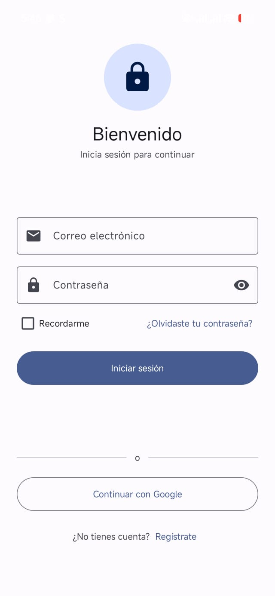
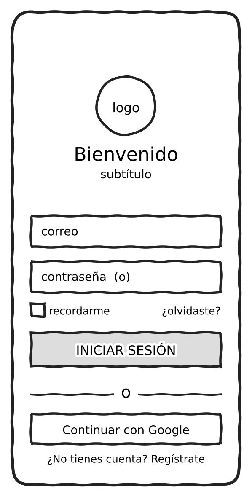
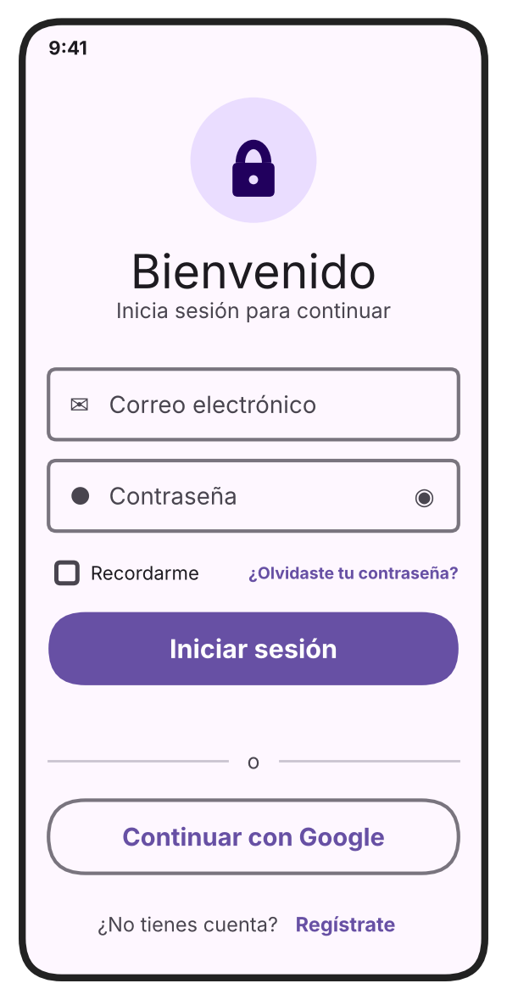
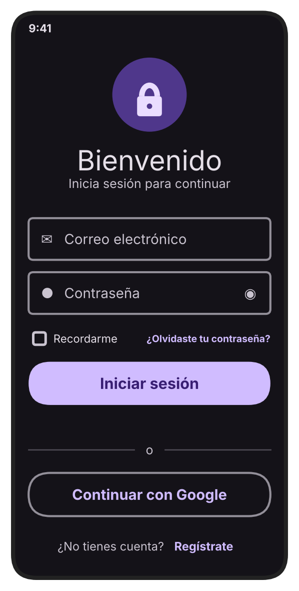
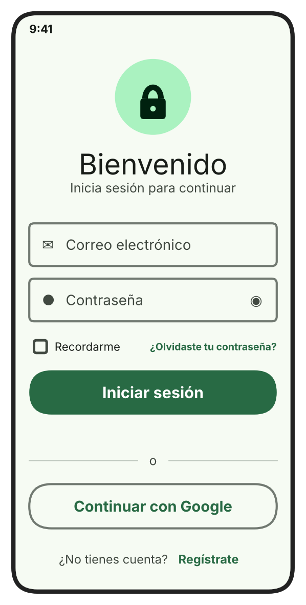
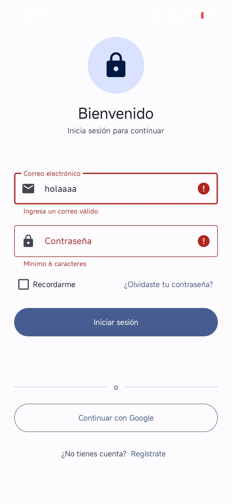

# Práctica · Interfaz de Login con Material Design 3 y Material You (Java)

> **Asignatura:** Diseño y Desarrollo de Interfaces Móviles
>
> **Institución:** TESOEM
>
> **Alumno:** Hernandez Sanchez Christopher Oswaldo · **Grupo:** 7S1

Aplicación Android de **una sola pantalla**, escrita en **Java** con vistas XML, que implementa el
diseño de una interfaz de **inicio de sesión**. La estructura se basa en `LinearLayout` (con
`layout_weight` y `0dp`), usa componentes de **Material Design 3** y adopta la paleta del sistema
con **Material You** (color dinámico) y el modo oscuro, sin colores fijos en el layout.

La práctica es **solo de diseño**: no hay conexión a base de datos ni a un servidor. La Activity
únicamente valida el *formato* de los campos para mostrar los estados de error de Material 3.

<p align="center">
  
  &nbsp;&nbsp;
  
  <br><em>Capturas reales de la app en el dispositivo: modo claro y modo oscuro.</em>
</p>

---

## Contenido

1. [Requisitos y versiones](#1-requisitos-y-versiones)
2. [Compilar y ejecutar](#2-compilar-y-ejecutar)
3. [Estructura del proyecto](#3-estructura-del-proyecto)
4. [Investigación: LinearLayout](#4-investigación-linearlayout)
5. [Cómo se activa Material Design 3](#5-cómo-se-activa-material-design-3)
6. [Cómo se activa Material You (color dinámico)](#6-cómo-se-activa-material-you-color-dinámico)
7. [Cómo se aplica Material 3 a los componentes](#7-cómo-se-aplica-material-3-a-los-componentes)
8. [Arquitectura de la pantalla](#8-arquitectura-de-la-pantalla)
9. [Fase de diseño: boceto, wireframe y mockup](#9-fase-de-diseño-boceto-wireframe-y-mockup)
10. [Recorrido por el código](#10-recorrido-por-el-código)
11. [Capturas de la implementación](#11-capturas-de-la-implementación)
12. [Errores comunes](#12-errores-comunes)
13. [Fuentes consultadas](#13-fuentes-consultadas)

---

## 1. Requisitos y versiones

| Elemento | Valor |
|---|---|
| Paquete (`namespace` / `applicationId`) | `mx.edu.tesoem.login` |
| Lenguaje | Java (scripts de Gradle en Kotlin DSL, como los genera Android Studio) |
| Plantilla de partida | Empty Views Activity |
| Tema base | `Theme.Material3.DayNight.NoActionBar` (`res/values/themes.xml`) |
| Biblioteca de diseño | `com.google.android.material:material` (ver `gradle/libs.versions.toml`) |
| `minSdk` / `targetSdk` / `compileSdk` | ver `app/build.gradle.kts` |
| Dispositivo de prueba | Xiaomi, Android 16 (API 36) |

> El color dinámico de Material You requiere **Android 12 (API 31) o superior** y que el fabricante
> lo implemente. En versiones anteriores, o en dispositivos que no lo aplican (como el Xiaomi de
> prueba), la app usa la paleta base del tema.

---

## 2. Compilar y ejecutar

1. Clona el repositorio:

   ```bash
   git clone https://github.com/Oswi24/login.git
   ```

2. Abre la carpeta en **Android Studio** y espera a que termine el *Gradle Sync*.
3. Conecta un teléfono con depuración USB o inicia un emulador (API 31 o superior).
4. Pulsa **Run ▶** (`app`).

Desde la terminal:

```bash
./gradlew assembleDebug
adb install -r app/build/outputs/apk/debug/app-debug.apk
```

| Comando | Significado |
|---|---|
| `./gradlew assembleDebug` | Usa el Gradle Wrapper (versión fija de Gradle) para compilar la variante *debug*: compila el Java, enlaza los recursos, genera el DEX y firma el APK con la llave de depuración. |
| `adb install -r` | Instala el APK en el dispositivo conectado; `-r` reemplaza la versión instalada conservando sus datos. |

---

## 3. Estructura del proyecto

```text
app/src/main/
├── AndroidManifest.xml ............... registra LoginApp y LoginActivity (adjustResize)
├── java/mx/edu/tesoem/login/
│   ├── LoginApp.java ................. activa Material You (DynamicColors)
│   └── LoginActivity.java ............ enlaza vistas y valida el formato de los campos
└── res/
    ├── layout/activity_login.xml ..... pantalla completa con LinearLayout
    ├── values/strings.xml ............ todos los textos de la interfaz
    ├── values/themes.xml ............. tema Material 3 DayNight
    └── drawable/
        ├── bg_logo.xml ............... círculo con rol colorPrimaryContainer
        ├── ic_lock.xml ............... icono vectorial «candado»
        └── ic_mail.xml ............... icono vectorial «correo»
docs/img/ ............................. boceto, wireframe, mockups y capturas
```

---

## 4. Investigación: LinearLayout

`LinearLayout` (paquete `android.widget`) es un `ViewGroup` que coloca a sus hijos **uno tras otro en
una sola dirección**: en columna (`orientation="vertical"`) o en fila (`orientation="horizontal"`, que
es el valor por defecto). El orden en que se escriben en el XML es el orden en que aparecen en pantalla.

### 4.1 Cómo mide y reparte el espacio

Cada `ViewGroup` dibuja en dos fases: **measure** (pregunta a cada hijo cuánto mide) y **layout** (le
asigna una posición). Cuando hay pesos (`layout_weight`), `LinearLayout` hace lo siguiente:

1. Mide primero a los hijos que no tienen peso.
2. Calcula el **espacio sobrante**.
3. Reparte ese sobrante en proporción a `layout_weight ÷ suma de pesos`.

En este login, las tres zonas de la pantalla tienen pesos 2, 3 y 2 (suma 7). Si el área disponible
fuera de 700 dp, recibirían 200, 300 y 200 dp.

### 4.2 Atributos del contenedor

| Atributo | Efecto |
|---|---|
| `android:orientation` | Dirección en la que se apilan los hijos. |
| `android:gravity` | Alinea el **contenido** dentro del propio contenedor (afecta a todos sus hijos). |
| `android:weightSum` | Suma total de pesos; si se omite, es la suma de los `layout_weight` de los hijos. |
| `android:padding*` | Espacio interior entre el borde del contenedor y sus hijos. |

### 4.3 Atributos que declaran los hijos

El prefijo `layout_` indica algo que el hijo **le pide a su padre**.

| Atributo | Efecto |
|---|---|
| `layout_width` / `layout_height` | `match_parent`, `wrap_content` o una medida fija. Con peso se usa `0dp` en la dimensión que se reparte. |
| `layout_weight` | Fracción del espacio **sobrante** que recibe el hijo. |
| `layout_gravity` | Cómo pide el hijo ser alineado en el eje perpendicular a la orientación (solo le afecta a él). |
| `layout_margin*` | Espacio exterior; se descuenta antes de repartir el sobrante. |

> **`gravity` y `layout_gravity`.** `gravity` lo escribe el contenedor y afecta a todos sus hijos;
> `layout_gravity` lo escribe un hijo y le afecta solo a él.

### 4.4 Por qué `0dp` con `layout_weight`

Si un hijo con peso declara `wrap_content`, primero se mide por su contenido y después se le suma una
parte del sobrante, lo que da resultados desiguales y obliga a medirlo dos veces (advertencia de Lint
*InefficientWeight*). Con `0dp` el tamaño lo decide **solo** el peso. Por eso las tres zonas del login
usan `layout_height="0dp"` y las filas horizontales usan `layout_width="0dp"`.

### 4.5 Qué se eligió y por qué

| Necesidad del diseño | Solución con LinearLayout |
|---|---|
| Dividir la pantalla en tres zonas proporcionales | Raíz vertical con tres hijos de `layout_weight` 2, 3 y 2 |
| Centrar el contenido de cada zona | `gravity="center"` / `gravity="center_vertical"` |
| Casilla a la izquierda y enlace a la derecha | Fila horizontal; la casilla con `0dp` + `layout_weight="1"` ocupa el espacio libre y empuja el enlace |
| Línea — «o» — línea | Fila horizontal con dos `View` de 1 dp y peso 1 a los lados del texto |
| Que no se corte en pantallas pequeñas o con teclado | `NestedScrollView` con `fillViewport="true"` como raíz |

---

## 5. Cómo se activa Material Design 3

**Material Design 3** es el sistema de diseño de Google: roles de color, escala tipográfica, formas,
movimiento y especificación de componentes. En vistas XML se implementa con la biblioteca **Material
Components for Android**. Se necesitan tres piezas:

### Pieza 1 · La dependencia

En `app/build.gradle.kts`:

```kotlin
dependencies {
    implementation(libs.appcompat)
    implementation(libs.material)
    implementation(libs.constraintlayout)
}
```

> Los scripts de Gradle usan Kotlin DSL (`.kts`) porque así los genera Android Studio; **todo el
> código de la aplicación es Java**.

### Pieza 2 · Un tema que hereda de `Theme.Material3.*`

En `res/values/themes.xml`:

```xml
<style name="Base.Theme.Loggin" parent="Theme.Material3.DayNight.NoActionBar" />
<style name="Theme.Loggin" parent="Base.Theme.Loggin" />
```

| Parte del nombre | Significado |
|---|---|
| `Theme.Material3` | Familia de temas M3: declara los roles de color, la tipografía, las formas y el estilo por defecto de cada componente. |
| `DayNight` | Android elige la variante clara u oscura según el modo oscuro del sistema. |
| `NoActionBar` | Sin la barra de acción del sistema; la pantalla del login no la necesita. |

El tema se asigna a toda la aplicación en el manifiesto con `android:theme="@style/Theme.Loggin"`.

### Pieza 3 · `AppCompatActivity` y el inflador Material

Con un tema Material, `AppCompatActivity` usa un inflador que **sustituye las etiquetas clásicas por su
versión Material** al leer el XML. Por eso `LoginActivity` hereda de `AppCompatActivity`:

| Etiqueta en el XML | Objeto que realmente se crea |
|---|---|
| `<Button>` | `MaterialButton` |
| `<CheckBox>` | `MaterialCheckBox` |
| `<TextView>` | `MaterialTextView` |

> Si el tema de la app no es Material, al inflar un componente Material la biblioteca lanza
> `IllegalArgumentException: The style on this component requires your app theme to be
> Theme.MaterialComponents (or a descendant)`.

---

## 6. Cómo se activa Material You (color dinámico)

**Material You** es el nombre con que se conoce la personalización de Android 12 basada en el **color
dinámico**: el sistema extrae colores del fondo de pantalla (o usa el que elige el usuario), define un
*color fuente* y genera con él paletas tonales que las aplicaciones pueden adoptar.

### `LoginApp.java`

```java
public class LoginApp extends Application {
    @Override
    public void onCreate() {
        super.onCreate();
        DynamicColors.applyToActivitiesIfAvailable(this);
    }
}
```

- `Application` se instancia **una sola vez y antes que cualquier Activity**, por lo que es el lugar
  indicado para configuraciones globales.
- `DynamicColors.applyToActivitiesIfAvailable(this)` registra un callback de ciclo de vida que, antes de
  que cada Activity infle su layout, aplica a su tema la paleta del sistema.
- Si el dispositivo no admite color dinámico, no hace nada y se conserva la paleta base del tema.

### Registro en `AndroidManifest.xml`

```xml
<application
    android:name=".LoginApp"
    android:theme="@style/Theme.Loggin"
    ... >
```

Sin `android:name=".LoginApp"` Android usaría la clase `Application` por defecto y el color dinámico
nunca se activaría.

### Del fondo de pantalla al botón

El botón **Iniciar sesión** no tiene ningún color escrito. Obtiene su fondo del rol `colorPrimary` del
tema; con color dinámico, ese rol apunta a un color generado desde el fondo de pantalla. Sin él, vale
el morado base de Material 3. El resultado es que **el mismo XML se ve distinto** según el dispositivo,
el fondo de pantalla y el modo claro u oscuro.

---

## 7. Cómo se aplica Material 3 a los componentes

### 7.1 Roles de color: `?attr` en lugar de colores fijos

Material 3 no asigna colores a los componentes sino **roles** (`colorPrimary`, `colorSurface`,
`colorPrimaryContainer`, `colorOutlineVariant`…). Cada rol tiene su pareja **on** (`colorOnSurface`,
`colorOnPrimaryContainer`…), pensada para el texto o el icono que va encima, lo que garantiza contraste.

`?attr/nombre` significa «lee el valor que el **tema actual** asigna a este atributo». Por eso cambia
con el modo oscuro y con Material You. `@color/nombre`, en cambio, es un valor fijo.

Roles usados en el login:

| Rol | Dónde se usa |
|---|---|
| `colorSurface` | Fondo de la pantalla |
| `colorOnSurface` | Título «Bienvenido» |
| `colorOnSurfaceVariant` | Subtítulo, textos secundarios y icono del correo |
| `colorPrimary` | Enlaces («¿Olvidaste tu contraseña?», «Regístrate») y botón relleno |
| `colorPrimaryContainer` | Fondo circular del logo (`bg_logo.xml`) |
| `colorOnPrimaryContainer` | Icono del candado sobre ese círculo |
| `colorOutlineVariant` | Líneas del separador «o» |

`res/drawable/bg_logo.xml`:

```xml
<shape xmlns:android="http://schemas.android.com/apk/res/android"
    android:shape="oval">
    <solid android:color="?attr/colorPrimaryContainer" />
</shape>
```

### 7.2 Estilos por defecto de los componentes

Un tema Material 3 define un estilo por defecto para cada componente. Para el login se usan estos:

| Componente | Estilo aplicado | Cómo se indica |
|---|---|---|
| Botón relleno (Iniciar sesión) | `Widget.Material3.Button` | Por defecto, sin `style` |
| Botón con contorno (Google) | Variante *Outlined* | `style="?attr/materialButtonOutlinedStyle"` |
| Campos de texto | Variante con contorno | `style="?attr/textInputOutlinedStyle"` |
| Casilla (Recordarme) | `Widget.Material3.CompoundButton.CheckBox` | Por defecto |

Para cambiar **una sola** instancia se escribe `style` en su etiqueta; para cambiar **todas** las de un
tipo se sobrescribe el atributo en el tema.

### 7.3 Escala tipográfica

Los textos usan la escala de Material 3 con `android:textAppearance="?attr/textAppearance…"`:

| Texto | Estilo |
|---|---|
| «Bienvenido» | `textAppearanceHeadlineMedium` |
| «Inicia sesión para continuar» | `textAppearanceBodyMedium` |
| Enlaces | `textAppearanceLabelLarge` |

---

## 8. Arquitectura de la pantalla

La app tiene una sola pantalla. La vista se declara en XML y la lógica mínima va en la Activity;
no existe capa de datos.

```text
NestedScrollView (raiz)
└─ LinearLayout vertical
   ├─ LinearLayout vertical  [weight 2]  ZONA 1: encabezado
   │   ├─ ImageView (logo circular)
   │   ├─ TextView (título)
   │   └─ TextView (subtítulo)
   ├─ LinearLayout vertical  [weight 3]  ZONA 2: formulario
   │   ├─ TextInputLayout > TextInputEditText (correo)
   │   ├─ TextInputLayout > TextInputEditText (contraseña, con mostrar/ocultar)
   │   ├─ LinearLayout horizontal: MaterialCheckBox + TextView (¿olvidaste…?)
   │   └─ MaterialButton (Iniciar sesión)
   └─ LinearLayout vertical  [weight 2]  ZONA 3: pie
       ├─ LinearLayout horizontal: línea + «o» + línea
       ├─ MaterialButton outlined (Continuar con Google)
       └─ LinearLayout horizontal: TextView + TextView (Regístrate)
```

| Elemento | Alto declarado | Resultado en pantalla |
|---|---|---|
| Zona 1 (encabezado) | `0dp` + `layout_weight="2"` | 2/7 del alto disponible |
| Zona 2 (formulario) | `0dp` + `layout_weight="3"` | 3/7 del alto disponible |
| Zona 3 (pie) | `0dp` + `layout_weight="2"` | 2/7 del alto disponible |

El `NestedScrollView` con `fillViewport="true"` mantiene ese reparto cuando la pantalla es grande y,
cuando no cabe todo (pantalla pequeña o teclado abierto), permite desplazar el contenido en lugar de
cortarlo.

---

## 9. Fase de diseño: boceto, wireframe y mockup

**Boceto (sketch).** Primer acercamiento a mano alzada: define la jerarquía visual (logo, saludo,
dos campos, acción principal, alternativa social y registro).

<p align="center"></p>

**Wireframe.** Esquema estructural sin color. Las líneas rojas marcan las tres zonas del
`LinearLayout` raíz, que se reparten la altura con `layout_weight` 2 : 3 : 2.

<p align="center"></p>

**Mockup.** Maquetado visual con los roles de color de Material 3: modo claro, modo oscuro y un
ejemplo de paleta dinámica distinta.

<p align="center">
  
  
  
</p>

---

## 10. Recorrido por el código

Los bloques siguientes son **extractos** de los archivos reales; el código completo está en el
repositorio.

### 10.1 La raíz y las tres zonas (`activity_login.xml`)

```xml
<androidx.core.widget.NestedScrollView
    android:id="@+id/raiz"
    android:layout_width="match_parent"
    android:layout_height="match_parent"
    android:background="?attr/colorSurface"
    android:fillViewport="true">

    <LinearLayout
        android:layout_width="match_parent"
        android:layout_height="match_parent"
        android:orientation="vertical"
        android:paddingStart="24dp"
        android:paddingEnd="24dp">

        <!-- ZONA 1: encabezado -->
        <LinearLayout
            android:layout_width="match_parent"
            android:layout_height="0dp"
            android:layout_weight="2"
            android:gravity="center"
            android:orientation="vertical">
            <!-- logo, título y subtítulo -->
        </LinearLayout>

        <!-- ZONA 2 (weight 3) y ZONA 3 (weight 2): misma estructura -->
    </LinearLayout>
</androidx.core.widget.NestedScrollView>
```

El fondo `?attr/colorSurface` y `fillViewport="true"` están en la raíz; las tres zonas comparten el alto
con `0dp` + `layout_weight`.

### 10.2 Campo de texto Material 3

```xml
<com.google.android.material.textfield.TextInputLayout
    android:id="@+id/til_contrasena"
    style="?attr/textInputOutlinedStyle"
    android:layout_width="match_parent"
    android:layout_height="wrap_content"
    android:hint="@string/hint_contrasena"
    app:endIconMode="password_toggle"
    app:startIconDrawable="@drawable/ic_lock">

    <com.google.android.material.textfield.TextInputEditText
        android:id="@+id/et_contrasena"
        android:layout_width="match_parent"
        android:layout_height="wrap_content"
        android:inputType="textPassword" />
</com.google.android.material.textfield.TextInputLayout>
```

- `TextInputLayout` es el contenedor M3: dibuja el borde, la etiqueta flotante (`hint`), el texto de
  error y los iconos. Dentro va un `TextInputEditText`, subclase de `EditText`.
- `endIconMode="password_toggle"` agrega el botón de ojo para mostrar u ocultar la contraseña.
- `startIconDrawable` coloca un icono vectorial al inicio del campo.
- `inputType="textPassword"` oculta los caracteres; en el campo de correo se usa `textEmailAddress`,
  que abre el teclado con la arroba.

### 10.3 Fila horizontal con peso

```xml
<LinearLayout
    android:layout_width="match_parent"
    android:layout_height="wrap_content"
    android:gravity="center_vertical"
    android:orientation="horizontal">

    <com.google.android.material.checkbox.MaterialCheckBox
        android:layout_width="0dp"
        android:layout_height="wrap_content"
        android:layout_weight="1"
        android:text="@string/recordarme" />

    <TextView
        android:id="@+id/tv_olvidaste"
        android:layout_width="wrap_content"
        android:layout_height="wrap_content"
        android:text="@string/olvidaste"
        android:textColor="?attr/colorPrimary" />
</LinearLayout>
```

La casilla ocupa todo el espacio que el enlace no necesita (`0dp` + peso 1), así que el enlace queda
pegado a la derecha sin necesidad de espaciadores.

### 10.4 Separador «o»

```xml
<LinearLayout ... android:orientation="horizontal" android:gravity="center_vertical">
    <View
        android:layout_width="0dp"
        android:layout_height="1dp"
        android:layout_weight="1"
        android:background="?attr/colorOutlineVariant" />
    <TextView android:text="@string/o" ... />
    <View ... android:layout_weight="1" ... />
</LinearLayout>
```

Dos vistas vacías de 1 dp de alto y peso 1 se reparten por igual el ancho que deja el texto «o».

### 10.5 Botones

```xml
<com.google.android.material.button.MaterialButton
    android:id="@+id/btn_ingresar"
    android:layout_width="match_parent"
    android:layout_height="56dp"
    android:text="@string/ingresar" />

<com.google.android.material.button.MaterialButton
    android:id="@+id/btn_google"
    style="?attr/materialButtonOutlinedStyle"
    android:layout_width="match_parent"
    android:layout_height="56dp"
    android:text="@string/google" />
```

El primero usa el estilo por defecto del tema (relleno, acción principal); el segundo pide la variante
con contorno (acción secundaria). Ambos miden 56 dp de alto, una altura cómoda para el pulgar.

### 10.6 Lógica de la pantalla (`LoginActivity.java`)

```java
btnIngresar.setOnClickListener(v -> validarFormulario());

private void validarFormulario() {
    String correo = etCorreo.getText() == null ? "" : etCorreo.getText().toString().trim();
    String clave = etContrasena.getText() == null ? "" : etContrasena.getText().toString();
    boolean valido = true;

    if (!Patterns.EMAIL_ADDRESS.matcher(correo).matches()) {
        tilCorreo.setError(getString(R.string.error_correo));
        valido = false;
    } else {
        tilCorreo.setError(null);
    }

    if (clave.length() < 6) {
        tilContrasena.setError(getString(R.string.error_contrasena));
        valido = false;
    } else {
        tilContrasena.setError(null);
    }

    if (valido) {
        mostrarMensaje(getString(R.string.msg_ok));
    }
}
```

- `findViewById` enlaza cada vista del XML con una variable Java.
- Los listeners se escriben como expresiones lambda (`v -> ...`).
- `Patterns.EMAIL_ADDRESS` es una expresión regular de Android para validar el formato del correo.
- `setError(texto)` hace que `TextInputLayout` pinte el borde y el mensaje en rojo; `setError(null)` lo
  limpia.
- **No se comprueban credenciales**: solo el formato. Cuando todo es válido, se muestra un `Snackbar`
  informativo.
- Los botones «Continuar con Google», «¿Olvidaste tu contraseña?» y «Regístrate» solo muestran un
  mensaje de demostración.

### 10.7 Textos (`strings.xml`)

Todos los textos de la interfaz están en `res/values/strings.xml`, lo que permitiría traducir la app
sin tocar el layout (bastaría con crear `res/values-en/strings.xml`).

---

## 11. Capturas de la implementación

<p align="center">
  
  
  
</p>

> **Nota sobre Material You.** El color dinámico está implementado (`LoginApp` + `DynamicColors`, y
> colores por rol `?attr/...` en el layout), pero no se incluye una captura de la paleta cambiando:
> el dispositivo de prueba (Xiaomi) no aplica el color dinámico de Android. El resultado esperado en
> un dispositivo compatible se muestra en el mockup con paleta dinámica de la sección 9.

---

## 12. Errores comunes

| Síntoma | Causa | Solución |
|---|---|---|
| `ClassNotFoundException: ...MainActivity` al abrir | La configuración de ejecución o el manifiesto apuntan a una Activity que ya no existe | Usar `LoginActivity` y *Launch: Default Activity* |
| `The file name must end with .xml` | Un archivo que no es `.xml` (por ejemplo `.iml`) quedó en `res/layout` | Borrarlo |
| `resource string/… not found` | `strings.xml` no tiene los textos que usa el layout | Copiar el `strings.xml` del proyecto |
| `requires Theme.MaterialComponents` | El tema de la app no hereda de Material | Heredar de `Theme.Material3.*` |
| Un hijo con peso no ocupa lo esperado | `wrap_content` o `match_parent` en la dimensión que se reparte | Usar `0dp` |
| Los colores no cambian con el fondo de pantalla | Falta `android:name=".LoginApp"`, el dispositivo es anterior a Android 12 o el fabricante no implementa el color dinámico | Registrar la clase Application y probar en un emulador con Android puro |

---

## 13. Fuentes consultadas

- Material Design 3: <https://m3.material.io>
- Material Components for Android: <https://github.com/material-components/material-components-android>
- Android Developers: [LinearLayout](https://developer.android.com/reference/android/widget/LinearLayout)
  y [Dynamic color](https://developer.android.com/develop/ui/views/theming/dynamic-colors)
- Presentación de la práctica 2: *LinearLayout con Material Design 3 y Material You en Android (Java)*, TESOEM.
