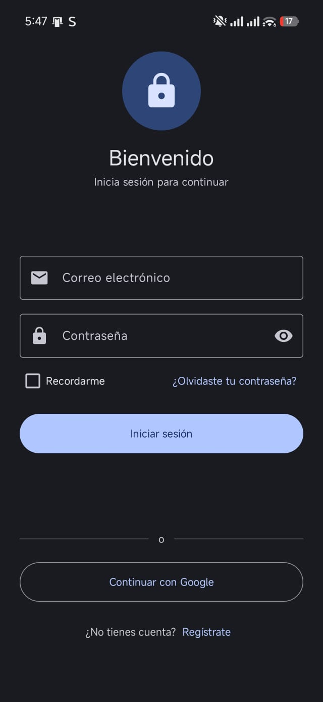
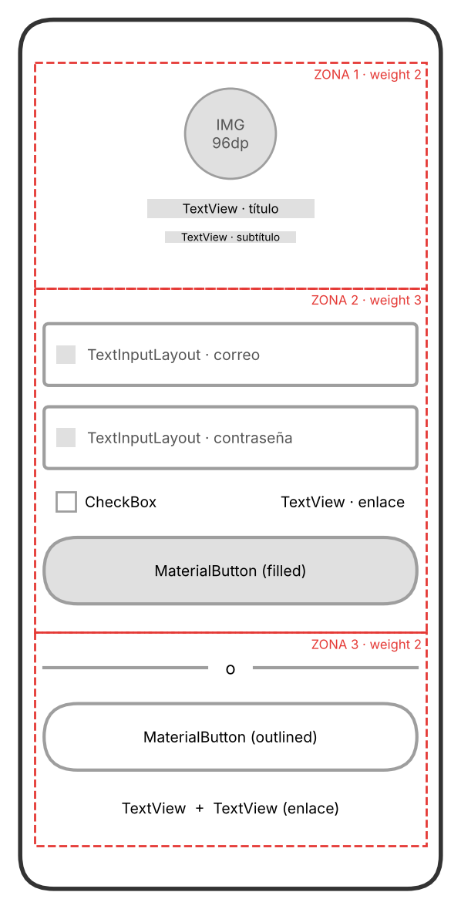

# Práctica · Interfaz de Login con Material Design 3 y Material You (Java)

> **Asignatura:** Diseño y Desarrollo de Interfaces Móviles
> **Institución:** TESOEM
> **Alumno:** Hernandez Sanchez Christopher Oswaldo · **Grupo:** 7S1

Aplicación Android de **una sola pantalla**, escrita en **Java** con vistas XML, que implementa el
diseño de una interfaz de **inicio de sesión**. La estructura se basa en `LinearLayout` (con
`layout_weight` y `0dp`), usa componentes de **Material Design 3** y adopta la paleta del sistema
con **Material You** (color dinámico) y el modo oscuro, sin colores fijos en el layout.

La práctica es **solo de diseño**: no hay conexión a base de datos ni a un servidor. La Activity
únicamente valida el *formato* de los campos para mostrar los estados de error de Material 3.

<p align="center">
  
  &nbsp;&nbsp;
  
  <br><em>Capturas reales de la app en el dispositivo: modo claro y modo oscuro.</em>
</p>

---

## Contenido

1. [Requisitos y versiones](#1-requisitos-y-versiones)
2. [Compilar y ejecutar](#2-compilar-y-ejecutar)
3. [Estructura del proyecto](#3-estructura-del-proyecto)
4. [Fase de diseño: boceto, wireframe y mockup](#4-fase-de-diseño-boceto-wireframe-y-mockup)
5. [Arquitectura de la pantalla](#5-arquitectura-de-la-pantalla)
6. [Cómo se activa Material Design 3](#6-cómo-se-activa-material-design-3)
7. [Cómo se activa Material You](#7-cómo-se-activa-material-you)
8. [Componentes utilizados](#8-componentes-utilizados)
9. [Capturas de la implementación](#9-capturas-de-la-implementación)
10. [Errores comunes](#10-errores-comunes)
11. [Fuentes consultadas](#11-fuentes-consultadas)

---

## 1. Requisitos y versiones

| Elemento | Valor |
|---|---|
| Paquete (`namespace` / `applicationId`) | `mx.edu.tesoem.login` |
| Lenguaje | Java (scripts de Gradle en Kotlin DSL, como los genera Android Studio) |
| Plantilla de partida | Empty Views Activity |
| Tema base | `Theme.Material3.DayNight.NoActionBar` (`res/values/themes.xml`) |
| Biblioteca de diseño | `com.google.android.material:material` (ver `gradle/libs.versions.toml`) |
| `minSdk` / `targetSdk` / `compileSdk` | ver `app/build.gradle.kts` |
| Dispositivo de prueba | Xiaomi, Android 16 (API 36) |

> El color dinámico de Material You requiere **Android 12 (API 31) o superior** y que el fabricante
> lo implemente. En versiones anteriores, o en dispositivos que no lo aplican (como el Xiaomi de
> prueba), la app usa la paleta base del tema.

---

## 2. Compilar y ejecutar

1. Clona el repositorio:
   ```bash
   git clone https://github.com/Oswi24/login.git
   ```
2. Abre la carpeta en **Android Studio** y espera a que termine el *Gradle Sync*.
3. Conecta un teléfono con depuración USB o inicia un emulador (API 31 o superior).
4. Pulsa **Run ▶** (`app`).

Desde la terminal:

```bash
./gradlew assembleDebug
adb install -r app/build/outputs/apk/debug/app-debug.apk
```

---

## 3. Estructura del proyecto

```text
app/src/main/
├── AndroidManifest.xml ............... registra LoginApp y LoginActivity (adjustResize)
├── java/mx/edu/tesoem/login/
│   ├── LoginApp.java ................. activa Material You (DynamicColors)
│   └── LoginActivity.java ............ enlaza vistas y valida el formato de los campos
└── res/
    ├── layout/activity_login.xml ..... pantalla completa con LinearLayout
    ├── values/strings.xml ............ todos los textos de la interfaz
    ├── values/themes.xml ............. tema Material 3 DayNight
    └── drawable/
        ├── bg_logo.xml ............... círculo con rol colorPrimaryContainer
        ├── ic_lock.xml ............... icono vectorial «candado»
        └── ic_mail.xml ............... icono vectorial «correo»
docs/img/ ............................. boceto, wireframe, mockups y capturas
```

---

## 4. Fase de diseño: boceto, wireframe y mockup

**Boceto (sketch).** Primer acercamiento a mano alzada: define la jerarquía visual (logo, saludo,
dos campos, acción principal, alternativa social y registro).

<p align="center"></p>

**Wireframe.** Esquema estructural sin color. Las líneas rojas marcan las tres zonas del
`LinearLayout` raíz, que se reparten la altura con `layout_weight` 2 : 3 : 2.

<p align="center"></p>

**Mockup.** Maquetado visual con los roles de color de Material 3: modo claro, modo oscuro y un
ejemplo de paleta dinámica distinta.

<p align="center">
  
  
  
</p>

---

## 5. Arquitectura de la pantalla

La app tiene una sola pantalla. La vista se declara en XML y la lógica mínima va en la Activity;
no existe capa de datos.

```text
NestedScrollView (raiz)
└─ LinearLayout vertical
   ├─ LinearLayout vertical  [weight 2]  ZONA 1: encabezado
   │   ├─ ImageView (logo circular)
   │   ├─ TextView (título)
   │   └─ TextView (subtítulo)
   ├─ LinearLayout vertical  [weight 3]  ZONA 2: formulario
   │   ├─ TextInputLayout > TextInputEditText (correo)
   │   ├─ TextInputLayout > TextInputEditText (contraseña, con mostrar/ocultar)
   │   ├─ LinearLayout horizontal: MaterialCheckBox + TextView (¿olvidaste…?)
   │   └─ MaterialButton (Iniciar sesión)
   └─ LinearLayout vertical  [weight 2]  ZONA 3: pie
       ├─ LinearLayout horizontal: línea + «o» + línea
       ├─ MaterialButton outlined (Continuar con Google)
       └─ LinearLayout horizontal: TextView + TextView (Regístrate)
```

Cada zona declara `layout_height="0dp"` y un `layout_weight`: `LinearLayout` mide primero a los
hijos sin peso y reparte el espacio sobrante en proporción 2 : 3 : 2. El `NestedScrollView` con
`fillViewport="true"` mantiene ese reparto en pantallas grandes y permite desplazar el contenido en
pantallas pequeñas o con el teclado abierto.

```xml
<LinearLayout
    android:layout_width="match_parent"
    android:layout_height="0dp"
    android:layout_weight="3"
    android:gravity="center_vertical"
    android:orientation="vertical">
    <!-- formulario -->
</LinearLayout>
```

La fila «Recordarme / ¿Olvidaste tu contraseña?» es un `LinearLayout` horizontal: el checkbox usa
`0dp` + `layout_weight="1"` y ocupa el espacio libre, empujando el enlace a la derecha.

---

## 6. Cómo se activa Material Design 3

Se necesitan tres piezas:

1. **La dependencia** `com.google.android.material:material` en `app/build.gradle.kts`
   (`implementation(libs.material)`).
2. **Un tema que hereda de `Theme.Material3.*`**, en `res/values/themes.xml`:
   ```xml
   <style name="Base.Theme.Loggin" parent="Theme.Material3.DayNight.NoActionBar" />
   <style name="Theme.Loggin" parent="Base.Theme.Loggin" />
   ```
   `DayNight` alterna entre claro y oscuro según el sistema; `NoActionBar` quita la barra de acción
   del sistema.
3. **`AppCompatActivity`** como clase base, para que el inflador de Material sustituya las vistas
   clásicas por sus versiones Material.

---

## 7. Cómo se activa Material You

`LoginApp.java` extiende `Application`, que se crea una sola vez y antes que cualquier Activity:

```java
public class LoginApp extends Application {
    @Override
    public void onCreate() {
        super.onCreate();
        DynamicColors.applyToActivitiesIfAvailable(this);
    }
}
```

Y se registra en `AndroidManifest.xml`:

```xml
<application
    android:name=".LoginApp"
    android:theme="@style/Theme.Loggin"
    ... >
```

El sistema genera una paleta a partir del fondo de pantalla; `DynamicColors` la aplica al tema de cada
Activity antes de inflar el layout. Como el layout usa **roles de color** (`?attr/colorPrimary`,
`?attr/colorSurface`, `?attr/colorOnSurface`, `?attr/colorOutlineVariant`…) y no colores fijos, la
interfaz cambia de paleta y de modo claro/oscuro sin modificar el XML.

---

## 8. Componentes utilizados

| Componente | Clase | Uso |
|---|---|---|
| Contenedor | `LinearLayout` / `NestedScrollView` | Estructura y desplazamiento |
| Campo de texto | `TextInputLayout` + `TextInputEditText` (`?attr/textInputOutlinedStyle`) | Correo y contraseña, con iconos y mostrar/ocultar clave |
| Botón relleno | `MaterialButton` | Iniciar sesión (acción principal) |
| Botón con contorno | `MaterialButton` (`?attr/materialButtonOutlinedStyle`) | Continuar con Google |
| Casilla | `MaterialCheckBox` | Recordarme |
| Mensajes | `Snackbar` | Retroalimentación de la demostración |

La validación (`LoginActivity.validarFormulario()`) solo comprueba formato: correo con
`Patterns.EMAIL_ADDRESS` y contraseña de al menos 6 caracteres. Los errores se muestran con
`TextInputLayout.setError()`. No se verifican credenciales.

---

## 9. Capturas de la implementación

<p align="center">
  
  
  
</p>

> **Nota sobre Material You.** El color dinámico está implementado (`LoginApp` + `DynamicColors`, y
> colores por rol `?attr/...` en el layout), pero no se incluye una captura de la paleta cambiando:
> el dispositivo de prueba (Xiaomi) no aplica el color dinámico de Android. El resultado esperado en
> un dispositivo compatible se muestra en el mockup con paleta dinámica de la sección 4.

---

## 10. Errores comunes

| Síntoma | Causa | Solución |
|---|---|---|
| `ClassNotFoundException: ...MainActivity` al abrir | La configuración de ejecución o el manifiesto apuntan a una Activity que ya no existe | Usar `LoginActivity` y *Launch: Default Activity* |
| `The file name must end with .xml` | Un archivo que no es `.xml` (por ejemplo `.iml`) quedó en `res/layout` | Borrarlo |
| `resource string/… not found` | `strings.xml` no tiene los textos que usa el layout | Copiar el `strings.xml` del proyecto |
| `requires Theme.MaterialComponents` | El tema de la app no hereda de Material | Heredar de `Theme.Material3.*` |
| Los colores no cambian con el fondo de pantalla | Falta `android:name=".LoginApp"` o el dispositivo es anterior a Android 12 | Registrar la clase Application |

---

## 11. Fuentes consultadas

- Material Design 3: <https://m3.material.io>
- Material Components for Android: <https://github.com/material-components/material-components-android>
- Android Developers: [LinearLayout](https://developer.android.com/reference/android/widget/LinearLayout)
  y [Dynamic color](https://developer.android.com/develop/ui/views/theming/dynamic-colors)
- Presentación de la práctica 2: *LinearLayout con Material Design 3 y Material You en Android (Java)*, TESOEM.
